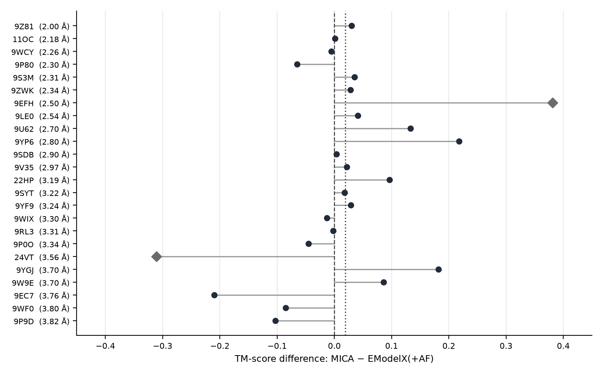
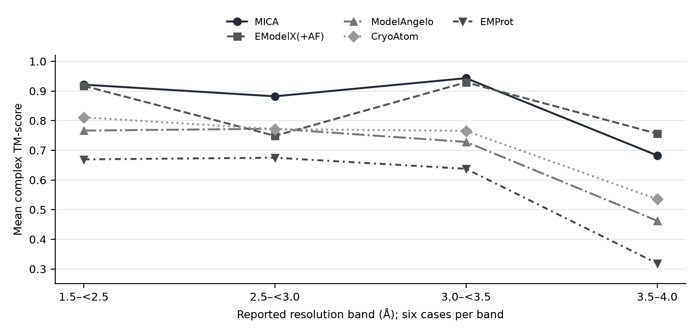

# Benchmarking MICA and recent cryo-EM protein model-building methods on 2026 EMDB/PDB entries

**Summary.** This report evaluates MICA against the original-paper baselines, ModelAngelo and EModelX(+AF), and two newer methods, CryoAtom and EMProt, on 24 cryo-EM maps with corresponding PDB structures reported as released in 2026. The cases were selected in four balanced resolution bands (1.5–4.0 Å), and all 120 five-method runs produced models. MICA achieved the highest mean complex TM-score (0.857) and led on 12 cases; its mean exceeded CryoAtom (0.721), ModelAngelo (0.683) and EMProt (0.575). Against EModelX(+AF) (0.838), however, the paired difference was only +0.019 (95% bootstrap interval −0.034 to +0.073). A different picture emerges from residue placement: CryoAtom and MICA had almost identical mean Cα quality (0.906 and 0.905), despite a large gap in complex-level TM-score. Differences in chain fragmentation, external structural priors, and reference coverage therefore matter to the interpretation of the ranking. MICA also performed less well in the 3.5–4.0 Å band (mean TM 0.683; EModelX(+AF) 0.756). The report examines these patterns at case level, documents execution and scoring decisions, and identifies comparisons needed to separate the performance of entire pipelines from the effects of their input configurations.

## 1. Task

Evaluate MICA [1] against ModelAngelo [2] and EModelX(+AF) [3], the two original-paper comparators, together with relevant newer methods, using cryo-EM maps and corresponding experimentally deposited protein structures first released in EMDB/PDB in 2026. This report treats the deposited structures as references for evaluation, while acknowledging that reference coverage and interpretation may vary between entries.

## 2. Methods evaluated

| Role | Method | Version used | Prior/template input |
|---|---|---|---|
| Subject | MICA | GitHub `jianlin-cheng/MICA` @ 726d1bb1; Zenodo 15756654 trained model | AlphaFold3 (AlphaFold Server) model_0 per entity |
| Paper baseline | ModelAngelo | 1.0.18 @ 994945bd; `nucleotides` weight bundle | none (map + sequence) |
| Paper baseline | EModelX(+AF) | @ 53713cf8; official weights | exact-sequence AlphaFold2 template per entity (ColabFold 1.6.3) |
| Newer, peer-reviewed | CryoAtom | v1.0.0 @ e2a31f2b; `checkpoints_v1.0` | none (map + sequence) |
| Newer, peer-reviewed | EMProt | v1.2 @ 9489d52e; authors' `weights.tgz` | none (map + sequence; optional predicted-model input not used) |
| Newer, preprint — added later (§6.8) | CryoZeta | @ c544c6bb; weights v0.0.1; authors' container image | sequence alignments per protein chain (ColabFold MMseqs2 server) |

The newer completed methods are CryoAtom [4] and EMProt [5]. CryoAtom uses an AlphaFold2-derived modeling architecture, and EMProt integrates learned structural information; describing either as completely free of structural priors would therefore be misleading. The relevant experimental distinction here is that neither pipeline was supplied with a separately predicted per-target structure, whereas MICA received AlphaFold3 models and EModelX(+AF) received AlphaFold2 templates. CryoZeta [6] is a later, diffusion-based extension whose results are reported separately (§6.8). This comparison consequently evaluates specified end-to-end configurations rather than architectural components under identical priors.

**CryoZeta status.** CryoZeta [6] incorporates experimental density into a diffusion-based structure-prediction pipeline and represents a particularly relevant later comparison. It was added after the five-method results were complete. All its runs on the same 24 cases had ended by 2026-10-14; the results are given separately in §6.8 and are not part of the five-method tables. DeepMainmast and Cryo2Struct (2024) were excluded because neither is newer than MICA nor one of the two original-paper baselines. Two later candidates were considered but not benchmarked. CryoACE [7] requires, for each map, a rough initial model already aligned to that map (its documentation suggests an unguided Boltz prediction) and does not specify how the alignment is to be made, so a run reflecting the authors' pipeline could not be defined within this study. E3-CryoFold (github.com/A4Bio/E3-CryoFold) was installed and run on two cases as a feasibility check only; its publication status was not verified, and it was not run on the benchmark set. Each included pipeline uses its documented settings except for the deviations recorded in §4.4.

## 3. Datasets

### 3.1 Screening (frozen 2026-10-04)

2026 EMDB pull at 1.5–4 Å: 7,730 unique maps → 5,326 explicit PDB–map links (5,322 PDB entries) → **3,856 maps passing the primary bulk metadata screen** → a 24-case candidate set: 6 per resolution band (1.5–<2.5, 2.5–<3.0, 3.0–<3.5, 3.5–4.0 Å), ordered within band by sha256 rank with seed 20261004; six scope-based same-band replacements. The six replaced entries and the reason for each are listed in Table 17: four filament or filament-end maps and two focused refinements of a sub-assembly, all identified from entry titles and metadata before any method was run. Every selected entry has an initial PDB release date and an initial EMDB map release date in 2026 (Table 16).

### 3.2 Benchmark set (locked 2026-10-06, before any method saw a case)

**Core: 12 cases = the 3 lowest-ranked per band** (`benchmark/selected12.csv`, rounds 1–3). Matches the scale of the MICA paper's own newly-released-map test (12 maps). Extension rule, fixed at the same time: further balanced rounds of 4 (one per band) up to 24; only complete rounds (every method has a recorded outcome, failures included) enter primary results; stopping decided on compute/time only (`case_rounds.csv`).

### 3.3 Extension to 24 cases (rounds 4–6)

The three extension rounds were run on 2026-10-10/11: round 4 = 9WCY, 9V35, 9YF9, 9EC7; round 5 = 9S3M, 9EFH, 9RL3, 9YGJ; round 6 = 11OC, 9YP6, 9P0O, 9W9E. **The decision to extend was taken after the core results were known.** The cases and their order were fixed before any method ran (`case_rounds.csv`), so no case was chosen with knowledge of results, but the decision itself was not blind. Core and extension are therefore also reported separately (Table 12).

### 3.4 Audits

1. **Full-map integrity — passed 24/24**: compressed-prefix and MRC-header sha256 match frozen values, gzip valid, size equals EMDB metadata, all values finite; coordinates/FASTA verified.
1. **Density/reference scope** — checked for the one case flagged by the results, 24VT, where MICA and EModelX(+AF) built 1.5–1.6× the deposited Cα count. Of their Cα farther than 3 Å from the deposited model (611 and 705), only 26% and 34% lie in density above the EMDB recommended contour, against 91% of the deposited model's own Cα (`benchmark/audit2/24VT_scope_audit.json`). The audit therefore found limited density support, at that contour, for most of the predicted residues that lie beyond the deposited model. It does not show that the deposited model is complete: that model contains 975 Cα for 2,879 residues in the deposited sequences (34%), so the analysis cannot establish whether every additional residue is incorrect, or whether some would be supported at another threshold. 24VT stays in the benchmark. Reference completeness is tabulated for all 24 cases in Table 16 (median 84%; lowest: 24VT 34%, 9Z81 46%, 9P9D 55%, 9YGJ 60%). Title-based flags (9P80, 9LE0, 9SYT) were not examined further.

Training and homology. Documented training windows used in the audit were MICA through April 2023, ModelAngelo before 1 April 2022, and EModelX from 2018 through May 2021; comparable final cutoffs were not established for EMProt and CryoAtom v1. For CryoZeta, the published dataset construction [6] used cryo-EM PDB entries released up to 1 October 2024, supplemented with entries collected on 30 June 2025, so no training entry was released after that date; its main network was initialised from Protenix weights [8], whose documented training cut-off is 30 September 2021 (30 June 2025 for a later "applied" Protenix model). The benchmark's reference structures and maps were first released between 14 January 2026 and 2 September 2026 (Table 16), so none falls within CryoZeta's training period by release date. All test entries are reported as released in 2026, but many entities had close PDB relatives (≥0.95 identity) released before May 2023. Recent deposition is therefore a temporal holdout for the specific deposited entries, rather than a guarantee that every component represents a previously unseen fold or sequence family. The predeclared lower-homology screen required <0.5 maximum pre-cutoff identity at ≥0.5 sequence coverage, with at least half the case residues satisfying this condition. Seven cases met the definition: 9SDB and 9SYT in the core, and 9V35, 9YF9, 9EC7, 9YGJ and 9W9E in the extension (benchmark/audit3_low_homology_by_case.json and its extension counterpart). Case 9YF9 qualified relative to the May 2023 cutoff only; a close relative was released subsequently.

## 4. Procedure

### 4.1 Inputs

Maps are converted losslessly to a canonical axis order (`canonicalize_map.py`; density region bitwise preserved; 27 world-coordinate landmarks checked per map). ModelAngelo receives the ≥128-voxel cube copy; other methods the canonical map. Deposited FASTA; entities ordered by entity number where a method requires it (sequences unchanged).

**Provenance of the predicted structures.** MICA's AlphaFold3 models came from the public AlphaFold Server, one job per entity, with job files written by MICA's `fasta_to_AF3_json.py`. The job files set no template or seed options, so the server's defaults applied: PDB templates enabled (`useStructureTemplate` defaults to true), no `maxTemplateDate` given, and one automatically chosen seed per job. The server's documentation does not state the default template cut-off date; it allows dates up to 2025-02-03, which is earlier than every benchmark entry's release. EModelX(+AF)'s AlphaFold2 templates were produced with ColabFold 1.6.3 (`colabfold_batch --num-models 5 --num-recycle 3 --random-seed 0`) using alignments from the ColabFold MMseqs2 server and no PDB templates (the `--templates` option was not used); the top-ranked model for each entity was supplied to EModelX. The same settings were used on both hardware platforms.

### 4.2 Coordinate frames

ModelAngelo, EModelX and MICA all write coordinates relative to the map's first voxel and ignore the MRC ORIGIN. Each prediction is shifted by its input map's recorded origin — a header-derived transform with no fitting to the reference. Verified on pilots: 96–100% of predicted Cα within 3 Å of a reference Cα after the shift. Map-frame and superposition-based scores are reported separately. All 24 benchmark maps have a zero origin after canonicalisation, so the shift is zero for every benchmark case. The same frame check was run on every scored model: ModelAngelo 0.94–1.00, EMProt 0.94–1.00, MICA 0.86–1.00, CryoAtom 0.90–1.00 and EModelX(+AF) 0.81–1.00, with three exceptions: 24VT (MICA 0.58, EModelX(+AF) 0.55), where the low values reflect the extra residues described in §3.4, and CryoAtom on 9V35 (0.71), where CryoAtom built 1.29× the deposited Cα count (§6.5).

### 4.3 Hardware

Two platforms were used, because the free Kaggle GPU quota ran out mid-benchmark.

- **Kaggle free tier** (Tesla T4 15 GB ×2, 4 vCPU): ModelAngelo, EModelX(+AF) and its AF2 templates for rounds 1–2 (8 cases); MICA steps 1–2 (AlphaFold3 processing and Phenix domain docking) for 7 of those cases.
- **USF GAIVI cluster** (`ClsGenAI` partition, one node: 4 × NVIDIA Titan RTX 24 GB, 64 cores, 196 GB RAM; 4 cores per GPU job, 16 per docking job): MICA `run.py` and refinement for all 24 cases; MICA docking for round 3, the remainder of 9U62 and all extension cases; ModelAngelo, EModelX(+AF) and AF2 templates for round 3 and the extension; CryoAtom and EMProt for all 24.

The canonical maps were regenerated on GAIVI and are density-identical to the Kaggle ones (every density hash and geometry field equal; file hashes differ only in header statistics). Wall times (Table 9) mix hardware and are not comparable to the paper's 24-core A100 timings. MICA's Phenix docking is CPU-bound and dominates its wall time (paper: 85–97%).

### 4.4 Recorded deviations

uv virtual environments instead of conda (same Python/PyTorch builds); `atom3d`/`freesasa` omitted (pinned but never imported); `matplotlib`/`scikit-learn` added for MICA (imported, not listed); AF2 templates from ColabFold rather than full AlphaFold2; 9WF0_1 AlphaFold3 job as a single copy (AlphaFold Server 5,000-token limit); MICA `batch_threshold` raised so every map uses MICA's own batch-size-1 inference path (its default batch of 8 exhausts a 15 GB T4 on large maps; model runs in eval/no-grad, so predictions are unaffected).

Further deviations recorded during the GAIVI runs:

- **MICA refinement.** `modules/phenix.sh` starts `phenix.real_space_refine` in the background and `run.py` exits at once; a batch scheduler then kills it. The same command (same Phenix 1.20.1-4487, `phenix.eff`, model, map, resolution) was run to completion as a separate job. The refined model is MICA's primary result; the unrefined `run.py` model is reported alongside (Table 6).
- **MICA docking worker count.** `dock_in_map.py` uses 0.6 × `multiprocessing.cpu_count()`. Under Slurm that call returns the node's 64 cores (38 workers in a 16-core job; `fork()` ran out of memory). A `sitecustomize.py` shim makes the call return the allocated cores, giving 9 workers (Kaggle: 2). No MICA file was changed.
- **MICA docking resume.** 9U62 (22 AlphaFold3 domains) exceeded one session; `dock_in_map.py`'s own resume (re-use of existing docked files) was used. Domains that had already ended "No solution found" against the same masked map were not retried. AlphaFold3 domains docked by Phenix (others: "No solution found"): 9U62 14/22, 9SYT 14/18, 9P9D 21/26, 9SDB 12/14, 24VT 9/11, 9ZWK 7/8; all domains for 9P80 (7), 9Z81 (12), 9LE0 (9), 22HP (5), 9WF0 (3), 9WIX (2).
- **EMProt chain labels (evaluation side).** EMProt writes all fragments matching one input sequence into one chain, separated only by residue-number jumps. Before chain-level scoring, chains of sequences present in more than one copy were split at fragment boundaries; chains of single-copy sequences were kept as written. The rule uses only the input FASTA; coordinates are unchanged. Scores under EMProt's raw labels and with every fragment split are in Table 7. The rule is needed because complex-mode TM-score pairs whole chains: under EMProt's raw labels, all copies of a multi-copy sequence form a single chain, which cannot be paired with the separate reference chains. The other four methods write a separate chain identifier for each chain or fragment they build, so their files were scored exactly as written. For every method the principle was the same: chain identifiers were taken from the method's own output unless they merged distinct copies, and no coordinate or residue assignment was changed. Cα quality, sequence match and map-frame precision/recall do not depend on chain labels.
- **Scratch and certificates.** GAIVI's node `/tmp` is a 2 GB tmpfs, so work directories and pip's temp directory were placed in the home file system; CryoAtom needed `SSL_CERT_FILE` to download ESM weights.
- **Low-confidence prior.** AlphaFold Server returned pTM 0.24 / ipTM 0.11 for the 9SYT_2 trimer; it was used as returned.

Deviations specific to the extension rounds (all on GAIVI; job identifiers are in the run log `BENCHMARK_PLAN.md`):

- **Single-copy AlphaFold3 job.** 9YF9_1 (12 copies) exceeds the server's 5,000-token limit and was submitted as one copy, as for 9WF0_1.
- **MICA scratch on the node's RAM disk.** `run.py` writes up to 60 GB of grid files per case, more than the home quota allows, so its work directory was placed in `/dev/shm`. That file system does not allow programs to be executed, so `--pulchra_path` points to the same PULCHRA binary in the home directory. Docking intermediates (`temp_maps`) were deleted while docking ran. No MICA file was changed.
- **Failed attempts caused by job scheduling on the shared node, rerun with identical commands.** The partition schedules cores and GPUs but not memory. (a) MICA's GPU step failed on the first attempt for nine cases (PULCHRA could not start from the RAM disk; two concurrent jobs filled it). (b) Three heavy jobs running together exhausted the node's memory: MICA's GPU step on 9YF9 (second attempt), EMProt on 9WCY, and EModelX(+AF) on 9YF9 (twice). Each was rerun unchanged with the heavy jobs queued one after another; EModelX(+AF) on 9YF9 completed only on its third attempt, with the node to itself (about 128 GB in use). These attempts produced no model and are not scored; reported run times are those of the successful run. The rule applied to every method: a failure counts as the method's outcome only if it recurs when the method has the node to itself.
- **Docking domains without a solution** (not retried, as in the core): 9EFH 2, 11OC 1; none in the other ten extension cases.
- **Evaluator time limit.** US-align needed more than the evaluator's 180 s limit on the largest complexes (9WCY: 24 chains, 5,614 Cα). The limit was made configurable and raised; one core case re-scored identically.

## 5. Evaluation metrics

The evaluator (evaluate.py) implements the six measures used in the MICA paper [1]: complex-mode, reference-normalised TM-score (US-align); aligned Cα length; sequence identity; Cα match (cctbx chain_comparison, with the paper’s prediction-denominator); Cα quality score (precision × coverage); and sequence match. Its seven recorded synthetic controls matched expected values for every metric. All six are tabulated per case in Appendix B: TM-score (Table 1), Cα quality (Table 2), sequence match (Table 3), aligned Cα length (Table 13), sequence identity (Table 14) and Cα match (Table 15). **Post hoc evaluator correction.** Two changes were made to the scoring after the first results had been inspected. Both apply to every method, and neither changes a model or the metric chosen before the runs (complex-mode, reference-normalised TM-score). First, the US-align build used for the first scoring, Version 20260920 (commit 1fa25a9), has an out-of-bounds bug in its complex-mode chain-assignment search, which its authors fixed on 2026-10-12. With that build the search returned different TM-scores for identical inputs (for CryoAtom on 22HP: 0.339, 0.733 and 0.277 in three runs). All models were therefore re-scored from the same Cα files with Version 20261012 (commit 746ad8a; binary SHA-256 `38218157…930cade3`), using `USalign prediction reference -mol prot -mm 1 -ter 1`, and once more with `-se`, which scores a model where it sits in the map's coordinate frame without a superposition search. Every method writes its model in that frame, so this is a valid superposition, and the reported TM-score is the higher of the two values; aligned Cα length and sequence identity are taken from the same evaluation. Relative to the first scoring, nine of the 120 five-method TM-scores rose by more than 0.01 (none for EModelX(+AF), one for MICA, three for ModelAngelo, four for CryoAtom and one for EMProt). The corrected search alone accounts for all of them except MICA on 24VT, where only the map-frame value is higher (0.548 against 0.509). Table 18 lists the first, search and map-frame values. Second, the reference is restricted to the polymer residues of the deposited model, so that free amino-acid ligands are not counted as protein; this changed one case (9P9D, 2,304 instead of 2,308 reference Cα). The supplementary evaluation uses one-to-one map-frame precision/recall/F1 at thresholds of 1/2/3/5 Å. Cα match is considered alongside coverage: in a pilot, a prediction covering only 9% of the reference achieved 100% Cα match but a Cα quality score of 0.090. Missing or empty models are treated as null rather than zero. Paired method differences use 95% case-bootstrap intervals (10,000 resamples; the generator is seeded with 20261004 for each comparison, so every table reports the same interval for the same comparison), with additional resolution- and homology-stratified summaries. All reported means weight cases equally rather than weighting by residue count.

**Reproducibility record.** A reproducibility package (`MICA_benchmark_reproducibility_package.zip`, dated 2026-10-13) is available on request. It contains the dataset manifest and selection files (`case_rounds.csv`, `selected12.csv`, the frozen 24-case candidate file with release dates and replacement reasons), the input sequences and deposited reference models, the audit outputs, the job scripts and per-run records for every method, the run log with execution decisions and job identifiers (`BENCHMARK_PLAN.md`), the evaluator and table-generation scripts (`evaluate.py`, `score_benchmark.py`, `scoring/make_tables.py`), the evaluator's per-model output, and the 192 model files that were scored (the five methods' final models plus the unrefined MICA models and the two alternative EMProt labelings), each with the SHA-256 recorded at scoring time. The 15 complete CryoZeta models and the 7 partial models, with their scores and run records, are in separately named folders of the same archive, as are the US-align evaluations of every model with both builds. Every number in the tables can be regenerated from these files. The maps themselves are not included; they are identified by EMDB accession and checksum and can be downloaded from EMDB. Phenix and the AlphaFold Server outputs are not redistributed.

## 6. Results

All 120 runs (24 cases × five completed methods) produced a non-empty final model; all six rounds therefore enter the reported primary set. Infrastructure-related reruns are documented in §4.4. Tables 1–18 in Appendix B and report/RESULTS_TABLES.md present the available scored outputs generated by scoring/make_tables.py. The charts in this report are drawn from those tables and represent no new inference runs.

### 6.1 Overall accuracy (24 cases)

| Method | Mean TM | Median TM | Mean Cα quality | Mean sequence match (%) | Mean map-frame precision / recall @3 Å | Best TM in |
|---|---|---|---|---|---|---|
| MICA | 0.857 | 0.929 | 0.905 | 93.8 | 0.937 / 0.908 | 12 cases |
| EModelX(+AF) | 0.838 | 0.885 | 0.863 | 89.6 | 0.929 / 0.867 | 8 cases |
| ModelAngelo | 0.683 | 0.650 | 0.822 | 97.6 | 0.982 / 0.822 | 1 case |
| CryoAtom | 0.721 | 0.725 | 0.906 | 96.5 | 0.947 / 0.908 | 3 cases |
| EMProt | 0.575 | 0.632 | 0.799 | 96.2 | 0.986 / 0.799 | 0 |

Per-case TM-scores (Table 1; rounds 1–3 = core, 4–6 = extension). Bold marks the highest value in a row and is decided on the unrounded scores, as are the counts of best-scoring cases:

| Case | Round | Res. (Å) | Ref. Cα | MICA | EModelX(+AF) | ModelAngelo | CryoAtom | EMProt |
|---|---|---|---|---|---|---|---|---|
| 9P80 | 1 | 2.30 | 908 | 0.810 | **0.875** | 0.542 | 0.761 | 0.710 |
| 9U62 | 1 | 2.70 | 3708 | 0.729 | 0.596 | 0.702 | **0.740** | 0.678 |
| 9WIX | 1 | 3.30 | 444 | 0.965 | **0.978** | 0.886 | 0.738 | 0.899 |
| 24VT | 1 | 3.56 | 975 | 0.548 | **0.859** | 0.734 | 0.616 | 0.489 |
| 9Z81 | 2 | 2.00 | 2280 | **0.990** | 0.960 | 0.613 | 0.580 | 0.525 |
| 9SDB | 2 | 2.90 | 1088 | 0.987 | 0.983 | 0.987 | **0.993** | 0.925 |
| 22HP | 2 | 3.19 | 634 | **0.928** | 0.832 | 0.611 | 0.733 | 0.765 |
| 9P9D | 2 | 3.82 | 2304 | 0.655 | **0.758** | 0.358 | 0.647 | 0.181 |
| 9ZWK | 3 | 2.34 | 1452 | **0.814** | 0.786 | 0.619 | 0.654 | 0.727 |
| 9LE0 | 3 | 2.54 | 1165 | **0.984** | 0.943 | 0.781 | 0.924 | 0.947 |
| 9SYT | 3 | 3.22 | 2507 | **0.914** | 0.896 | 0.580 | 0.538 | 0.346 |
| 9WF0 | 3 | 3.80 | 5333 | 0.751 | **0.836** | 0.645 | 0.615 | 0.205 |
| 9WCY | 4 | 2.26 | 5614 | 0.934 | 0.939 | **0.981** | 0.894 | 0.809 |
| 9V35 | 4 | 2.97 | 266 | **0.972** | 0.950 | 0.866 | 0.632 | 0.824 |
| 9YF9 | 4 | 3.24 | 7704 | **0.982** | 0.953 | 0.646 | 0.734 | 0.336 |
| 9EC7 | 4 | 3.76 | 1917 | 0.522 | **0.732** | 0.207 | 0.472 | 0.123 |
| 9S3M | 5 | 2.31 | 967 | **0.982** | 0.947 | 0.845 | 0.981 | 0.506 |
| 9EFH | 5 | 2.50 | 2133 | 0.634 | 0.253 | 0.654 | **0.716** | 0.340 |
| 9RL3 | 5 | 3.31 | 2980 | 0.941 | **0.943** | 0.936 | 0.939 | 0.894 |
| 9YGJ | 5 | 3.70 | 3087 | **0.872** | 0.690 | 0.573 | 0.587 | 0.795 |
| 11OC | 6 | 2.18 | 1372 | **0.999** | 0.998 | 0.998 | 0.998 | 0.740 |
| 9YP6 | 6 | 2.80 | 4404 | **0.987** | 0.769 | 0.646 | 0.625 | 0.337 |
| 9P0O | 6 | 3.34 | 1855 | 0.929 | **0.974** | 0.710 | 0.912 | 0.587 |
| 9W9E | 6 | 3.70 | 3448 | **0.749** | 0.663 | 0.259 | 0.276 | 0.120 |

### 6.2 MICA against each method (paired, Table 10)

| MICA − … | TM-score: mean difference (95% interval) | Cα quality: mean difference (95% interval) |
|---|---|---|
| EModelX(+AF) | +0.019 (−0.034 to +0.073); MICA higher in 15/24 | +0.042 (+0.002 to +0.097); 15/24 |
| ModelAngelo | +0.175 (+0.109 to +0.240); 21/24 | +0.084 (+0.043 to +0.131); 19/24 |
| CryoAtom | +0.136 (+0.073 to +0.205); 20/24 | −0.001 (−0.025 to +0.025); 14/24 |
| EMProt | +0.282 (+0.197 to +0.372); 24/24 | +0.107 (+0.061 to +0.160); 21/24 |

The small MICA–EModelX(+AF) difference in TM-score is imprecisely estimated on these 24 cases: the interval includes zero, and the advantage changes direction between the core and extension (§6.3). Cα quality favors MICA by +0.042 on average, but the interval begins at +0.002; that outcome should be interpreted with the same attention to individual cases as the TM-score comparison.

MICA has higher mean complex TM-score than ModelAngelo, CryoAtom and EMProt, with the paired intervals excluding zero. These are comparisons of the specified complete pipelines, including their distinct inputs and output representations.

CryoAtom and MICA are effectively level on mean Cα quality (0.906 versus 0.905; ten best-scoring cases each). ModelAngelo, CryoAtom and EMProt have higher sequence-match percentages and map-frame precision, but these conditional and local measures do not by themselves quantify how much of the target was built or assembled into connected chains.

### 6.3 Core and extension shown separately (Table 12)

Mean TM-score per method; M = MICA, E = EModelX(+AF).

| Set | n | MICA | EModelX (+AF) | Model Angelo | Cryo Atom | EMProt | MICA − EModelX(+AF), 95% interval | Best TM: M / E / other |
|---|---|---|---|---|---|---|---|---|
| Core (rounds 1–3) | 12 | 0.840 | 0.858 | 0.672 | 0.711 | 0.616 | −0.019 (−0.088 to +0.038) | 5 / 5 / 2 |
| Extension (rounds 4–6) | 12 | 0.875 | 0.817 | 0.693 | 0.730 | 0.534 | +0.058 (−0.019 to +0.141) | 7 / 3 / 2 |
| All | 24 | 0.857 | 0.838 | 0.683 | 0.721 | 0.575 | +0.019 (−0.034 to +0.073) | 12 / 8 / 4 |

The MICA–EModelX(+AF) difference changes sign between the two equally sized sets, and neither half separates the two methods. The twelve extension cases were ordered before execution, but the decision to extend was made after observing the core (§3.3); the pooled estimate should therefore be read with both component estimates. MICA’s TM-score advantage over the three configurations run without separate per-target structural templates remains in each half.

*Figure 1. Per-case complex TM-score differences between MICA and EModelX(+AF), sorted by reported resolution. Dashed line: zero; dotted line: mean paired difference (+0.019). Diamonds identify 24VT and 9EFH, the two influential cases discussed in §6.9. Source: Table 1; plotted values were rounded to three decimals in the source table.*

### 6.4 Why complex TM-score and local Cα quality diverge

The apparent disagreement between metrics is informative rather than simply contradictory. ModelAngelo, CryoAtom and EMProt often predict multiple fragments for a reference chain (EMProt's single output chain for the 13-chain 9WF0 contains 84 separate fragments, counted from the residue-numbering breaks in its output file). Complex-mode US-align scoring is sensitive to how those fragments are grouped and matched to reference chains, whereas Cα quality and map-frame recall credit local placements regardless of whether the residues form long, correctly registered chains. For example, CryoAtom scores 0.996 in Cα quality on 9Z81 while reaching only 0.580 in TM-score. The first scoring also showed how fragile the superposition step can be for such models: for CryoAtom on 22HP it returned a superposition with 5.8% sequence identity and a TM-score of 0.339, although the model sits correctly in the map (TM-score 0.733 and 95.1% sequence identity with the corrected US-align build). This was traced to a bug in the build first used, and all models were re-scored (§5, Table 18). With the corrected scores the mean MICA–CryoAtom TM-score gap is 0.136 instead of 0.178: part of the original separation came from the evaluation procedure, while a substantial difference remains. In this benchmark, TM-score was chosen in advance to retain sensitivity to globally coherent complexes; the other measures are necessary to distinguish poor placement from incomplete assembly. The EMProt case is a further warning against treating a score as independent of representation: its mean TM-score is 0.575 with the copy-aware labeling rule, compared with 0.429 using original labels and 0.463 with every fragment separated (Table 7). The coordinates are unchanged. The labeling intervention improves interpretability of the complex score, not the physical predictions themselves.

### 6.5 Resolution, homology and model size

**Resolution.** In the three bands below 3.5 Å, MICA’s mean TM-scores are 0.921, 0.882 and 0.943, without a monotonic decline across these particular cases. In the 3.5–4.0 Å band, the mean falls to 0.683. EModelX(+AF) records 0.917, 0.749, 0.929 and 0.756 across the same four bands, and leads MICA in four of the six coarsest cases (24VT, 9P9D, 9WF0 and 9EC7). ModelAngelo (0.463) and EMProt (0.319) show especially low mean TM-scores in that band (Table 11). These are associations within small, heterogeneous groups of six; nominal global resolution does not isolate local density quality, molecular size or assembly complexity.

**Homology.** Under the predeclared screening definition, the seven lower-homology cases yield mean TM-scores of 0.857 for MICA and 0.838 for EModelX(+AF), almost the same as their means on the other 17 cases (0.858 and 0.838). The corresponding means for CryoAtom, ModelAngelo and EMProt are 0.604, 0.588 and 0.496 on the seven cases, versus 0.769, 0.721 and 0.608 elsewhere (Table 8). Because the subset is small, three cases fall in the 3.5–4.0 Å band and the cutoff is relative to specific historical PDB releases, the pattern cannot establish homology-robust generalization. It identifies a follow-up stratification to study with a larger sample and more stringent similarity controls.

**Model size and reference scope.** On 24VT, MICA and EModelX(+AF) built 1.48 and 1.61 times the deposited Cα count, with map-frame precision of 0.570 and 0.534 (Table 5). The targeted audit found that only 26% and 34% of their extra Cα atoms farther than 3 Å from the reference lie above the recommended map contour (§3.4). This suggests weak density support under that particular threshold, but it does not by itself establish that every additional residue is incorrect: deposition can omit modeled or weakly resolved regions, and a contour is an imperfect proxy for local evidential support. CryoAtom also produced an oversized model on 9V35 (1.29×; precision 0.696), which was not subjected to the same density check. Under-building is visible elsewhere: EModelX(+AF) recovered only 0.43× the deposited Cα count on 9EFH (TM 0.253), while ModelAngelo and EMProt built 0.29× and 0.20× on 9EC7. MICA’s smallest relative output was 0.76× on 9W9E.

*Figure 2. Mean complex TM-score by reported resolution band (six cases per band). These descriptive means show the notably lower scores in the 3.5–4.0 Å group, without adjusting for other differences between cases. Source: Table 11; no additional experiments.*

### 6.6 MICA refinement and run time

Refinement changed MICA’s TM-score by no more than 0.0030 on any case (Table 6); the mean is 0.857 with refinement and 0.857 without. This result concerns the structural similarity measure used here; it does not test refinement’s effects on stereochemistry, clashes or independent map–model fit.

- Docking dominated MICA's wall time: 6–1,151 min per case, against 4–271 min for `run.py` and 3–40 min for refinement (Table 9). The other methods took 3–268 min per case on a single GPU (ModelAngelo 8–86, CryoAtom 5–232, EMProt 3–51, EModelX(+AF) 3–268); EModelX(+AF) additionally needs AF2 templates (3–294 min) and MICA AlphaFold3 predictions from AlphaFold Server.
- The largest case, 9YF9 (7,704 Cα), took 271 min in MICA's GPU step, 268 min in EModelX(+AF) and 232 min in CryoAtom, and EModelX(+AF) needed about 128 GB of memory. Extension times were measured on a node shared with other jobs of this benchmark.

### 6.7 Limits of this benchmark

The conclusions apply to 24 cases selected through the recorded screening procedure, with one run per method and case rather than repeated random seeds. The decision to extend the core sample was made after the core scores were known, so the larger set is best viewed as a documented extension rather than an entirely blinded confirmatory sample. Resolution bands are balanced by design; the resulting means describe this benchmark, not the natural distribution of all 2026 EMDB releases. The low-homology subgroup is small, and close historical PDB relatives exist for many entities. Exact training and template exposure cannot be ruled out solely from 2026 deposition dates.

Comparability is also limited by the pipelines’ different external priors: MICA used AlphaFold3 server predictions, EModelX(+AF) used ColabFold-derived AlphaFold2 templates, and the other methods were run without separate external predicted models, including EMProt without its optional model input. These are valid documented configurations, but they are not a matched-prior ablation. Hardware changed from Kaggle to GAIVI; shared-node contention and infrastructure reruns prevent a controlled speed ranking. Two AlphaFold3 jobs were submitted as single-copy chains because of server limits. The complex TM-score depends on a superposition search; a bug affecting it in the US-align build first used was found and corrected after the first scoring (§5, Table 18). PDB references are imperfect proxies for truth, and direct density/reference scope was checked only for 24VT, although reference completeness is reported for every case (Table 16). CryoZeta is a later extension reported separately (§6.8), with a model for only part of the 24 cases. Engineering-only pilots are recorded separately in scoring/PILOT_SCORES_ModelAngelo.md.

### 6.8 CryoZeta (added after the five-method benchmark)

CryoZeta was evaluated as an extension on the same 24-case target set, with the same maps and sequences as the other methods and the same evaluator. All 24 entries were released after the end of CryoZeta's training data by date (§3.4). By 2026-10-14, when the last run ended, 15 cases had produced a complete model, eight attempted cases had ended without a final model under the documented pipeline, and one was not attempted because a shorter chain had already exceeded the available GPU memory. CryoZeta was added after the five-method results were known, so it is reported here only and is not merged into Tables 1–18.

- **Set-up.** The authors' container image and wrapper scripts with default settings (seed 101, 5 samples, 20 diffusion steps, 10 cycles); normal mode for cases up to 2,800 residues (11 cases) and large-complex mode above that (13 cases), as the documentation recommends; if normal mode ran out of GPU memory, large-complex mode was tried once; map contour at the EMDB recommended level; the top-ranked model is the one scored. This protocol was fixed before any benchmark case was run.
- **Hardware caveat.** CryoZeta's documentation asks for a GPU with at least 32 GB; the available cards have 24 GB.
- **Outcomes.** Of the 15 complete models, 7 were built in normal mode, 3 in large-complex mode after normal mode ran out of GPU memory, and 5 in large-complex mode. Of the eight cases without a final model, 9U62 ran out of GPU memory in large-complex mode on its 1,663-residue chain, and for 9EC7, 9P9D, 9RL3, 9SYT, 9WCY, 9Z81 and 9ZWK the large-complex pipeline stopped with an error: it places one chain copy per stage and exits when too little unassigned density remains to place the next copy, without writing the stages already built. 9YGJ was not attempted because its longest chain (2,189 residues) exceeds the one that ran out of memory.

| Case | Res. (Å) | Ref. Cα | CryoZeta mode | CryoZeta Cα built ÷ ref. | CryoZeta TM | MICA TM | EModelX(+AF) TM |
|---|---|---|---|---|---|---|---|
| 9P80 | 2.30 | 908 | normal | 1.33× | **0.998** | 0.810 | 0.875 |
| 9WIX | 3.30 | 444 | normal | 1.23× | **0.982** | 0.965 | 0.978 |
| 24VT | 3.56 | 975 | large | 2.95× | 0.659 | 0.548 | **0.859** |
| 9SDB | 2.90 | 1088 | normal | 1.10× | **0.996** | 0.987 | 0.983 |
| 22HP | 3.19 | 634 | normal | 1.00× | **0.990** | 0.928 | 0.832 |
| 9LE0 | 2.54 | 1165 | normal | 1.05× | **0.998** | 0.984 | 0.943 |
| 9WF0 | 3.80 | 5333 | large | 1.05× | **0.997** | 0.751 | 0.836 |
| 9V35 | 2.97 | 266 | normal | 1.48× | **0.978** | 0.972 | 0.950 |
| 9YF9 | 3.24 | 7704 | large | 1.19× | 0.969 | **0.982** | 0.953 |
| 9S3M | 2.31 | 967 | normal | 1.07× | **0.998** | 0.982 | 0.947 |
| 9EFH | 2.50 | 2133 | large (after normal mode ran out of GPU memory) | 1.26× | **0.673** | 0.634 | 0.253 |
| 11OC | 2.18 | 1372 | large (after normal mode ran out of GPU memory) | 1.00× | 0.999 | **0.999** | 0.998 |
| 9YP6 | 2.80 | 4404 | large | 1.10× | **0.996** | 0.987 | 0.769 |
| 9P0O | 3.34 | 1855 | large (after normal mode ran out of GPU memory) | 1.00× | 0.709 | 0.929 | **0.974** |
| 9W9E | 3.70 | 3448 | large | 1.00× | 0.656 | **0.749** | 0.663 |

| Mean over the 15 cases | CryoZeta | MICA | EModelX(+AF) | ModelAngelo | CryoAtom | EMProt |
|---|---|---|---|---|---|---|
| TM-score | 0.907 | 0.880 | 0.854 | 0.721 | 0.750 | 0.582 |
| Cα quality | 0.945 | 0.921 | 0.870 | 0.842 | 0.926 | 0.828 |
| Map-frame precision @3 Å | 0.814 | 0.938 | 0.929 | 0.979 | 0.938 | 0.986 |
| Map-frame recall @3 Å | 0.949 | 0.924 | 0.874 | 0.842 | 0.927 | 0.829 |

On the 15 cases with a complete model, CryoZeta's mean TM-score is higher than MICA's (0.907 against 0.880); it is higher than MICA in 11 of 15 cases and the highest of the six methods in 9. The paired difference from MICA is +0.026 (−0.025 to +0.078) and from EModelX(+AF) it is +0.053 (−0.027 to +0.131), with 95% bootstrap intervals in parentheses. Both intervals include zero, so these 15 cases do not separate CryoZeta from the two prior-conditioned pipelines; with 15 cases this is an absence of resolution, not evidence that the methods are equivalent. Its mean differences from ModelAngelo, CryoAtom and EMProt (+0.186, +0.156 and +0.325) have intervals that exclude zero.

**Pattern by run mode (post hoc description).** The seven cases built in normal mode (393–1,227 input residues) all score between 0.978 and 0.998 (mean 0.992, against 0.947 for MICA and 0.930 for EModelX(+AF) on the same cases), and CryoZeta is above MICA in all seven. The eight built in large-complex mode are divided: four score 0.969 or higher (9WF0, 9YF9, 11OC, 9YP6) and four lie between 0.656 and 0.709 (24VT, 9EFH, 9P0O, 9W9E); their mean is 0.832 against 0.822 for MICA, and CryoZeta is above MICA in four. The largest single gain is 9WF0 (0.997 against 0.751 for MICA and 0.836 for EModelX(+AF)), and the largest assembly in the set, 9YF9 (7,704 reference Cα), was completed with a TM-score of 0.969 against 0.982 for MICA. On 9P0O and 9W9E CryoZeta is below MICA (0.709 against 0.929; 0.656 against 0.749) although its models have exactly the reference residue count; its Cα quality there is 0.890 and 0.733, so on these two cases the lower score reflects residue placement and not model size. Run mode and assembly size are confounded in this sample, because the large-complex cases are also the larger assemblies; the pattern describes these runs and is not evidence about the mode itself.

**Cautions.** First, this is a subset defined by completion: the cases without a complete CryoZeta model are not in these means, so the comparison is not equivalent to the 24-case results. Second, CryoZeta outputs every residue of the input sequences, including regions absent from the deposited model (up to 2.95× the reference size on 24VT). The reference-normalised TM-score does not penalise this, while map-frame precision does, and CryoZeta's mean precision is the lowest of the six. Where recall is close to 1, its precision is close to the ratio of deposited to built residues (9P80: recall 1.000, precision 0.750 with 1.33× the reference), and where the built and deposited sizes coincide (22HP, 11OC) precision is 0.987 and 0.996; where the sizes differ, much of the lower mean precision (0.814) therefore reflects residues outside the deposited model, which this evaluation cannot classify as right or wrong. Third, the runs used 24 GB cards where the documentation asks for 32 GB. The records attribute two things to that limit: the 9U62 failure, and the fallback of four cases (9EFH, 11OC, 9P0O, 9ZWK; 1,372–2,688 input residues) from normal to large-complex mode. The seven early stops showed no out-of-memory message (peak use 8,505–22,013 MiB of 24,576), so these records do not attribute them to the memory limit.

**Partial models (reported separately).** The stopped large-complex runs were repeated with one change to the pipeline script (`cycle_predict.py`): five added lines write the list of completed stages at the start of every stage, so that CryoZeta's own combine step can be run on the stages finished before the stop. The change adds file output only and modifies no numerical step (the diff is in the reproducibility package); output identity with the unmodified script was not tested by a paired run. The models below are therefore incomplete by construction and are not CryoZeta results under its documented pipeline; they show what had been built when the pipeline stopped. Four cases have no run under the unmodified script: 9P9D, which stopped at the last of its 8 stages; 9WCY, which stopped after 19 of its 24 stages; and 9WF0 and 9YF9, which completed all 13 and all 12 stages and are among the 15 complete models above.

| Case | Res. (Å) | Ref. Cα | Stages completed | Cα built ÷ ref. | Partial-model TM | Partial-model Cα quality | MICA TM | EModelX(+AF) TM |
|---|---|---|---|---|---|---|---|---|
| 9Z81 | 2.00 | 2280 | 9 of 12 | 1.63× | 0.701 | 0.813 | 0.990 | 0.960 |
| 9P9D | 3.82 | 2304 | 7 of 8 | 1.74× | 0.782 | 0.766 | 0.655 | 0.758 |
| 9ZWK | 2.34 | 1452 | 3 of 4 | 1.00× | 0.909 | 0.862 | 0.814 | 0.786 |
| 9SYT | 3.22 | 2507 | 3 of 6 | 1.16× | 0.916 | 0.937 | 0.914 | 0.896 |
| 9WCY | 2.26 | 5614 | 19 of 24 | 1.09× | 0.771 | 0.727 | 0.934 | 0.939 |
| 9EC7 | 3.76 | 1917 | 6 of 9 | 1.07× | 0.575 | 0.706 | 0.522 | 0.732 |
| 9RL3 | 3.31 | 2980 | 12 of 13 | 1.01× | 0.904 | 0.856 | 0.941 | 0.943 |

Read with that restriction, the partial models add three observations (post hoc description). The stops came late: in three of the seven cases at the last stage (9P9D, 9ZWK, 9RL3), and in the other four with three to five chain copies still to place. What had been built is of mixed accuracy: the partial model has a higher TM-score than MICA's complete model in four cases (9P9D, 9ZWK, 9SYT, 9EC7) and a lower one in three (9Z81: 0.701 against 0.990; 9WCY: 0.771 against 0.934; 9RL3: 0.904 against 0.941); its Cα quality is within 0.04 of MICA's in the first four and lower in the other three (0.813 against 0.987; 0.727 against 0.945; 0.856 against 0.942). Two partial models are already much larger than the deposited structure (9Z81 1.63×, 9P9D 1.74×) with map-frame precision of 0.500 and 0.447, because the input sequences hold about twice the deposited residue count (4,956 and 4,220 against 2,280 and 2,304).

As a sensitivity check only, counting the seven partial models together with the 15 complete ones gives a mean TM-score of 0.871 over 22 cases, against 0.863 for MICA on the same 22. This is lower than the 0.907 of the completed subset, which illustrates the first caution above: the cases CryoZeta completed are those on which it scored higher. The two cases with no model at all (9U62, 9YGJ; 3,087–3,708 reference Cα) are among the larger assemblies, so the 22-case figure is not a 24-case result either.

Two targeted checks would separate the explanations left open here. Re-running the memory-limited and stopped cases on a card with the documented 32 GB would show how much of the incompleteness is a property of this hardware. Scoring CryoZeta's models after restricting them to the residues present in the deposited structure would separate misplaced residues from residues that the reference lacks, which the present precision values cannot do.

### 6.9 Influence of individual cases (post hoc sensitivity check)

Because the pooled MICA–EModelX(+AF) difference is small compared with its case-to-case variation, a simple influence check was calculated directly from the rounded Table 1 TM-scores. Across all 24 cases, the mean difference is +0.0194. Omitting 9EFH, which favors MICA by +0.381, changes it to +0.0037 (n = 23). Omitting 24VT, which favors EModelX(+AF) by 0.311, changes it to +0.0337 (n = 23). Omitting both yields +0.0180 (n = 22). The opposing influence of these cases largely cancels in the pooled estimate. This diagnostic was motivated by the observed scores and was not part of the frozen benchmark protocol; no cases were removed from the primary analysis. It suggests focusing case inspection on assembly completeness, prior conditioning and map-supported coverage rather than asserting a stable ordering from the small mean difference.

## 7. Discussion and conclusions

On the 24-case 2026 EMDB/PDB sample, MICA yields the highest mean complex TM-score (0.857) among the five methods evaluated on all 24 cases, and has the best score in 12 of them. Its margin over ModelAngelo, CryoAtom and EMProt is appreciable in the paired comparisons, but the outcome against EModelX(+AF) is much narrower: +0.019 on average, with a 95% bootstrap interval from −0.034 to +0.073. The original MICA paper [1] found a clearer benefit over EModelX(+AF) on its test sets. This evaluation supports MICA’s competitiveness on newer entries while leaving the relative performance of these two prior-conditioned pipelines unresolved. It is particularly important that the full set is an equally weighted collection of cases, not a residue-weighted aggregate: a small assembly and a multi-thousand-residue complex each exert one unit of influence on the reported mean.

The case-level results explain why the overall MICA–EModelX(+AF) comparison should be treated cautiously. The core twelve cases favor EModelX(+AF) by 0.019 TM-score on average; the later twelve favor MICA by 0.058. Both intervals span zero. The unusually low EModelX(+AF) score for 9EFH (0.253, alongside a model containing only 43% of the reference Cα count) contributes heavily to MICA’s small overall lead, while 24VT favors EModelX(+AF) by 0.311 TM-score despite both methods building unusually large models. A leave-one-out calculation using the rounded values in Table 1 reduces the mean MICA advantage to +0.0037 without 9EFH, and increases it to +0.0337 without 24VT (§6.9). These observations identify cases to inspect, rather than proving a mechanism or warranting post hoc exclusion. They also qualify direct comparison with the MICA paper, because the present EModelX(+AF) configuration received exact-sequence AlphaFold2 templates for each entity and the AlphaFold3 inputs were generated separately through a public server.

A second result is the separation between local placement and coherent reconstruction of an entire complex. CryoAtom’s mean Cα quality (0.906) is almost identical to MICA’s (0.905), yet its mean complex TM-score is 0.721 rather than 0.857. Its 9Z81 result makes the contrast unusually clear (Cα quality 0.996; TM-score 0.580). The fragment counts and EMProt’s sensitivity to chain labeling support the view that some apparent accuracy deficits reflect continuity, chain assignment or the structure of the output representation, rather than uniformly misplaced residues. The original EModelX study [3] similarly distinguished sequence-guided completion from locally accurate initial traces. A useful next comparison would therefore report correct residue placement, coverage, fragment-length distributions and chain-aware assembly scores together, preferably under scoring conventions that do not award an arbitrary advantage to one output-label scheme.

The coarsest-resolution cases warrant a different kind of caution. MICA averages 0.683 TM-score at 3.5–4.0 Å, versus 0.756 for EModelX(+AF); the other methods generally fall further. The 24VT audit reveals that many residues added beyond the deposited reference by the two prior-conditioned pipelines occupy regions below the chosen map contour. That pattern is consistent with model completion being pushed beyond strongly supported density in at least one case. It is not, by itself, proof that the added coordinates are false: a deposited model can be incomplete, local resolution varies within a map, and contour thresholds simplify the evidence. A stronger test would combine local map–model correlation or density-supported coverage with an explicit reference-completeness audit, examining whether structural priors help recover supported regions and where they risk imposing unjustified geometry. Such evaluation would be more informative than treating the PDB structure as an exhaustive ground truth.

The seven lower-homology cases offer a useful diagnostic but a limited generalization test. MICA and EModelX(+AF) have nearly unchanged mean TM-scores across this screen-defined subgroup and the other seventeen cases, whereas the other methods score lower on the subgroup. Resolution and homology are entangled here, and the threshold measures similarity to PDB entries available by a specified historical date rather than the true exposure of every model or predictor to related folds. Thus, releasing a reference structure in 2026 is valuable for temporal evaluation, but does not establish that the sequences, templates or folds are novel to every model under comparison. A larger, prespecified holdout with documented prediction/template provenance and stratification by local resolution and chain multiplicity would be needed to test the pattern robustly.

Finally, the accuracy gain of a complete pipeline must be considered alongside its execution cost and the scope of what its final stages change. MICA’s Phenix docking accounts for 6–1,151 minutes per case in the recorded runs, whereas its final real-space refinement changes TM-score by at most 0.0030. The latter result should be evaluated further with stereochemical and direct density-fit measures before drawing an efficiency conclusion about refinement. Because the hardware and workloads differ, the timings here are descriptive and cannot establish a cross-method speed ranking. The most informative follow-up work is therefore targeted rather than simply larger: compare selected methods under more closely matched structural-prior inputs; examine the difficult and influential cases under chain-independent and chain-aware scores; report local density agreement and reference scope; and repeat predictions where stochastic variation is material. The CryoZeta [6] results in §6.8 were added after the five-method results and should be read as a separate, later analysis. On the 15 cases it completed, its mean TM-score (0.907) is above MICA's (0.880), with a paired interval that includes zero; all seven cases that ran in its normal mode scored 0.978 or higher, while eight larger assemblies ended without a final model (one for lack of GPU memory on the available 24 GB cards, seven when the pipeline stopped). Whether a density-conditioned structure predictor of this kind keeps that accuracy on large multi-chain complexes, all 24 of which MICA and EModelX(+AF) completed, is the comparison these runs leave open. Taken together, the 24-case benchmark points to a practical research question: how to preserve the global completeness offered by structural prediction while making residue placement, connectivity and confidence accountable to the experimental map.

## References

[1] Gyawali, R., Dhakal, A. & Cheng, J. Multimodal deep learning integration of cryo-EM and AlphaFold3 for high-accuracy protein structure determination. Communications Chemistry 8, 320 (2025). https://doi.org/10.1038/s42004-025-01718-5

[2] Jamali, K., Käll, L., Zhang, R. et al. Automated model building and protein identification in cryo-EM maps. Nature 628, 450–457 (2024). https://doi.org/10.1038/s41586-024-07215-4

[3] Chen, S., Zhang, S., Fang, X. et al. Protein complex structure modeling by cross-modal alignment between cryo-EM maps and protein sequences. Nature Communications 15, 8808 (2024). https://doi.org/10.1038/s41467-024-53116-5

[4] Su, B., Huang, K., Peng, Z. et al. CryoAtom improves model building for cryo-EM. Nature Structural & Molecular Biology 33, 351–361 (2026; published online 2025). https://doi.org/10.1038/s41594-025-01713-3

[5] Li, T., Chen, J., Li, H. et al. EMProt improves structure determination from cryo-EM maps. Nature Structural & Molecular Biology 33, 341–350 (2026; published online 2025). https://doi.org/10.1038/s41594-025-01723-1

[6] Zhang, Z., Li, S., Farheen, F. et al. Accurate Macromolecular Complex Modeling for Cryo-EM with CryoZeta. bioRxiv preprint (2026). https://doi.org/10.64898/2026.02.13.705846. Implementation: https://github.com/kiharalab/CryoZeta

[7] Li, M., Li, M., Qin, W. et al. CryoACE: An Atom-centric Framework for Accurate and Automated Model Building in Cryo-EM. ICML 2026; arXiv preprint arXiv:2606.31332 (2026). https://arxiv.org/abs/2606.31332. Implementation: https://github.com/Cellverse/CryoACE

[8] Chen, X., Zhang, Y., Lu, C. et al. Protenix – Advancing Structure Prediction Through a Comprehensive AlphaFold3 Reproduction. bioRxiv preprint (2025). https://doi.org/10.1101/2025.01.08.631967. Implementation: https://github.com/bytedance/Protenix

## Appendix A — Pilot findings that shaped the protocol

- One pilot (EMD-77112/13KK) produced empty final models for all three methods; its deposited model covers only 32% of the sequence.
- On a pilot whose deposited FASTA under-states the assembly (9W66, 1 copy vs 2-copy assembly), methods following the FASTA copy count built one chain; MICA's chain crossed between protomers. The 24 benchmark cases do not have this mismatch (all `oper_expression = 1`).
